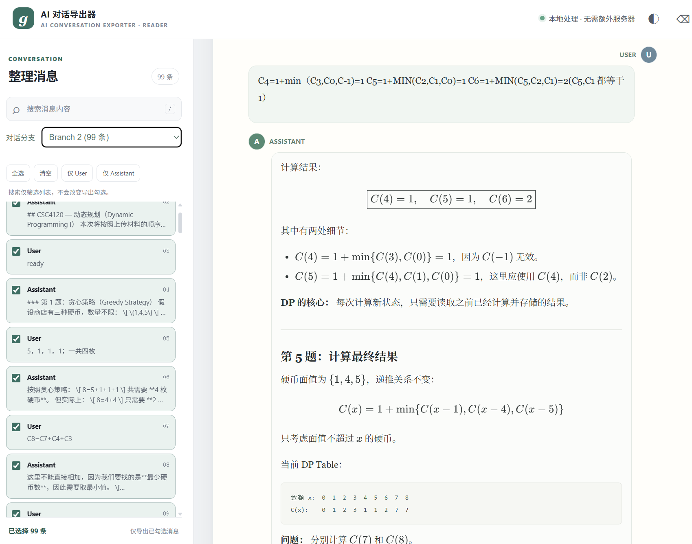
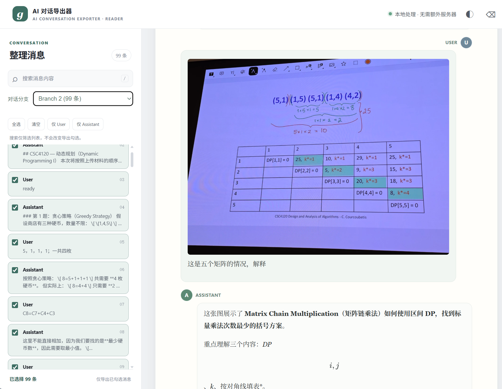
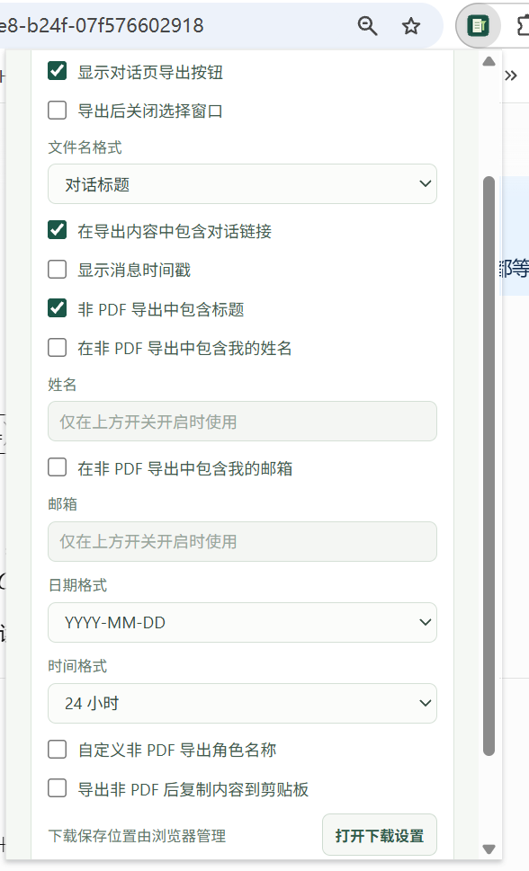

# AI 对话导出器 · AI Conversation Exporter

将 AI 网页对话整理成可保存的文档。独立实现的 Chrome / Edge Manifest V3 扩展，中文界面；渲染库和字体随源码附带，运行时不加载 CDN。

**1.5 新增**：预览自动尝试读取所选 ChatGPT 图片，预览和 PDF 采用左右区分角色的聊天布局；默认隐藏可识别的工具调用、思考消息和引用标记。点击浏览器工具栏图标可调整导出按钮、文件名、时间等设置。

**1.4.1 修复**：补上 kimi.ai 与 www.kimi.ai 的域名识别和内容脚本匹配，修复在 `https://www.kimi.ai/en` 等页面不显示导出按钮的问题。

**1.4 新增**：Claude、Qwen、DeepSeek、Kimi、Gemini、豆包、Grok 的页面对话适配，以及更大、居中的下拉箭头。这些平台读取已加载页面消息，不需要 API Key，也不会调用模型生成接口。平台范围与 DOM 兼容性说明见 [多平台支持](docs/platforms.md)。

**1.3 新增**：点击 SELECT 打开导出页；鼠标悬停右侧小按钮，选择 All、Questions 或 Answers 即可直接下载 PDF，无需进入导出页。

**1.1 新增**：完整对话树与分支选择、共享/临时对话读取、图片与原始附件嵌入、KaTeX 公式、Mermaid，以及直接在浏览器内生成 PDF。支持 Markdown、TXT、HTML、JSON、CSV；系统打印作为备用入口。实现与限制见 [1.1 升级说明](docs/upgrade-1.1.md)。

## 功能展示

**对话选择与公式预览**



**对话中的图片预览**



**导出设置**



## 安装源码

1. 用 Git 获取本仓库：`git clone https://github.com/loeness/GptExporter.git`。
2. 打开 Chrome 的 `chrome://extensions`（Edge 使用 `edge://extensions`），开启“开发者模式”。
3. 选择“加载已解压的扩展程序”，选中仓库里的 **`extension` 文件夹**。
4. 刷新已打开的受支持 AI 对话页面。在对话页点击 SELECT 打开导出预览；浏览器工具栏的扩展图标用于调整设置。

安装不需要 Node.js、构建、注册账号或 API Key。要求 Chromium 114 或更新版本。仓库只交付源码，不提供 ZIP、CRX、Release 附件或打包下载入口。

## 使用

打开具体对话，等待回答生成完成，然后打开预览。ChatGPT 优先从当前登录会话读取结构化历史与所有返回分支，默认选择当前路径；可切换其他分支或全部分支。无法读取完整数据时会回退页面 DOM，并明确标记“部分数据”。其他平台读取当前页面已加载的消息，预览中会标明平台和读取范围；不会自动翻页或读取账号内全部对话。

对话页右下角的 **SELECT** 主按钮直接进入导出页，可选择消息、分支与文件格式。鼠标移到右侧小按钮时会显示三个快捷选项，点击后直接下载当前分支的 PDF：

- **All**：全部消息。
- **Questions**：仅提问，即用户消息。
- **Answers**：仅回答，即助手消息。

快捷范围在 ChatGPT 中应用于取得的当前分支历史，在其他平台中应用于当前页面实际识别到的消息。悬停只展开菜单，点击选项才导出；不打开预览或新标签页，也不在对话中插入复选框。鼠标可从小按钮移入菜单；触屏可点小按钮，键盘可用方向键、Enter、Escape。PDF 默认 A4 纵向，文件保存到浏览器下载位置；其他格式及自定义设置可通过 SELECT 使用。

点击浏览器工具栏里的扩展图标可调整导出按钮、文件名和完成后是否关闭预览。对话链接、时间戳、角色标签、手动填写的姓名或邮箱，以及导出后复制到剪贴板等设置用于非 PDF 格式。姓名和邮箱默认不导出。浏览器管理下载位置。

在导出页点击 **预览 PDF**，可按实际分页查看文档，调整正文字号（8–13 pt）、紧凑度、纸张和方向。默认 9 pt 和紧凑布局。点击 **下载 PDF** 保存当前预览的文件，也可从预览工具栏打印。

PDF 正文保留用户提问、助手答案、公式及可读取的上传图片。导出会移除可识别的时间戳、分支标记、生成的图表和 SVG 源码，以及引用、思考和工具信息。正文可以搜索，成功取得的用户文件保存在 PDF 附件面板。

预览会并行读取所选 ChatGPT 消息中的图片，大图在本机缩放或压缩。保持原对话页打开，点击 **嵌入图片与附件** 可读取附件或重试失败的图片。HTML 支持离线查看内嵌的图片、公式、图表与附件，Markdown/JSON 保留公式和 Mermaid 源码。搜索只筛选消息列表，勾选决定导出范围。

CSV 按 RFC 4180 引号与换行规则生成；可能被电子表格识别为公式的字段会前置单引号，避免打开表格时执行公式。

## 数据与权限

- 只读取当前打开的对话。ChatGPT 为取得完整历史，在该页已有登录会话内调用会话接口；访问令牌仅在请求函数闭包中暂用，不写入模型、存储、日志或导出文档。其他平台只读页面 DOM，不观察其登录请求或获取访问令牌。不会读取浏览器凭据文件。
- 预览的对话文字、分支和媒体元数据暂存在 `chrome.storage.session` 中，浏览器会话结束时清空。预览内可主动清除，超过 24 小时的记录在下次打开预览时清理。快捷导出在内存中处理，结束或失败时关闭临时渲染文档。单次对话模型上限 8 MB，预览缓存总预算 9 MB。
- 媒体只在内存中处理。单张输入图片上限 20 MB，单个文件附件上限 12 MB，处理后的媒体总预算 40 MB。只允许当前对话解析出的 ChatGPT/oaiusercontent 媒体及带签名的 Azure Blob 地址；其他外站图片保留为链接，不会抓取。保持源对话标签页打开以刷新过期的文件地址。
- `chrome.storage.local` 仅保存界面偏好。无数据上传、遥测、账号或支付系统。
- 新增平台当前优先支持文字、代码及可提取的公式/图表源码；原始图片、文件附件和历史分支接口尚未接入，不会自动请求这些平台的媒体服务。图片保留可取得的链接或替代文字。
- `storage` 用于暂存与偏好；`offscreen` 用于无标签页的本地文档渲染；`downloads` 用于快捷保存文件并确认本次下载完成；`clipboardWrite` 用于用户开启复制后写入非 PDF 导出内容。声明式内容脚本只匹配平台注册表内的明确域名；当前仍保留 `activeTab` 和 `scripting` 权限。
- 无远端脚本或外部消息接口。新增平台主机权限用于注入页面读取器；ChatGPT 媒体权限与 Azure Blob 的签名校验范围保持原有设置。预览和 HTML 导出清理危险标签、属性与 URL；活动附件类型作为下载用二进制处理，不在页面执行。

## 范围与限制

“完整”仅指本次会话接口实际返回且结构完整的消息树，不代表能访问已删除、服务拒绝或从未取得的数据。共享/临时会话取决于页面 loader、流式响应和当前接口可用性；扩展加载前已经结束且无可读记录的临时对话，无法凭空恢复。接口变化、403、失效附件、超大媒体和不支持的渲染会明确提示。

内部消息与引用按已知消息类型、标记和页面结构识别；各平台格式变化时可能存在遗漏。其他 AI 平台仍只读取页面中已加载的内容，图片原始文件尚不能保证取得。

数据流见 [架构说明](docs/architecture.md)，依赖来源与许可证见 `extension/vendor/provenance.json` 和 `extension/vendor/licenses/`。

## 开发与验证

Node.js 22+：

```sh
npm ci
npm run check
npm test
```

浏览器集成检查需要 Playwright Chromium。高级及快捷导出检查还需要 Python 和 `pypdf`，用于读取实际下载的 PDF 内容（均为开发验证依赖）：

```sh
npx playwright install chromium
npm run test:browser
npm run test:advanced
npm run test:selection
npm run test:platforms
```

可以通过 `GPT_EXPORTER_TEST_PYTHON` 指定已安装 `pypdf` 的 Python 绝对路径；通过 `PLAYWRIGHT_BROWSERS_PATH` 指定测试用浏览器缓存。运行插件本身不需要这些开发工具。

测试使用合成对话与模拟会话接口，不访问真实账号。基础浏览器检查覆盖原有流程；高级检查覆盖完整消息树、分支、共享/临时会话、富内容、原始附件、离线 HTML 和直接 PDF。真实 API 与用户账号的兼容性仍需实际使用验证。截图、测试 PDF、失败日志在忽略的 `test-results/`，不作为下载包发布。GitHub Actions 只执行源码和单元检查，不上传构建产物。

修改渲染依赖后运行 `npm run build:vendor` 重建本地 bundle 与许可证清单；Noto 字体来源和 SHA-256 已记录，构建不会自动下载或替换字体。

`extension/` 可直接加载；`scripts/` 为资源检查和原创图标生成脚本；`tests/` 为测试；`docs/` 为调查与架构记录。
